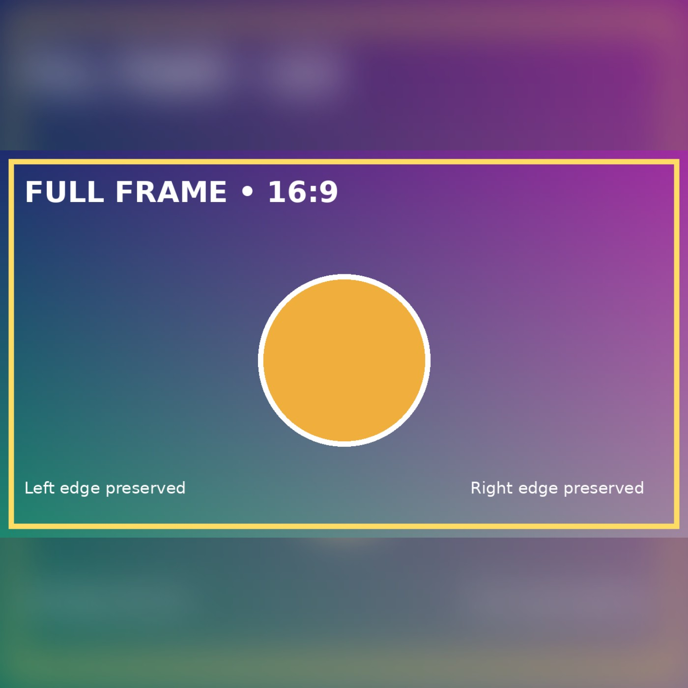

# Podsync


[](https://github.com/mxpv/podsync/actions?query=workflow%3ACI)
[](https://github.com/mxpv/podsync/actions/workflows/nightly.yml)
[](https://github.com/mxpv/podsync/releases)
[](https://goreportcard.com/report/github.com/mxpv/podsync)
[](https://github.com/sponsors/mxpv)
[](https://www.patreon.com/podsync)

Podsync - is a simple, free service that lets you listen to any YouTube / Vimeo channels, playlists or user videos in
podcast format.

Podcast applications have a rich functionality for content delivery - automatic download of new episodes,
remembering last played position, sync between devices and offline listening. This functionality is not available
on YouTube and Vimeo. So the aim of Podsync is to make your life easier and enable you to view/listen to content on
any device in podcast client.

## ✨ Features

- Works with YouTube and Vimeo.
- Supports feeds configuration: video/audio, high/low quality, max video height, etc.
- mp3 encoding
- Update scheduler supports cron expressions
- Episodes filtering (match by title, duration).
- Feeds customizations (custom artwork, category, language, etc).
- OPML export.
- Supports episodes cleanup (keep last X episodes).
- Configurable hooks for custom integrations and workflows.
- One-click deployment for AWS.
- Runs on Windows, Mac OS, Linux, and Docker.
- Supports ARM.
- Automatic yt-dlp self update.
- Supports API keys rotation.

## 📋 Dependencies

If you're running the CLI as binary (e.g. not via Docker), you need to make sure that dependencies are available on
your system. Currently, Podsync depends on `yt-dlp` ,  `ffmpeg`, and `go`.

On Mac you can install those with `brew`:
```
brew install yt-dlp ffmpeg go
```

## 📖 Documentation

- [How to get Vimeo API token](./docs/how_to_get_vimeo_token.md)
- [How to get YouTube API Key](./docs/how_to_get_youtube_api_key.md)
- [Podsync on QNAP NAS Guide](./docs/how_to_setup_podsync_on_qnap_nas.md)
- [Schedule updates with cron](./docs/cron.md)

## 🌙 Nightly builds

Nightly builds uploaded every midnight from the `main` branch and available for testing:

```bash
$ docker run -it --rm ghcr.io/mxpv/podsync:nightly
```

### 🔑 Access tokens

In order to query YouTube or Vimeo API you have to obtain an API token first.

- [How to get YouTube API key](https://elfsight.com/blog/2016/12/how-to-get-youtube-api-key-tutorial/)
- [Generate an access token for Vimeo](https://developer.vimeo.com/api/guides/start#generate-access-token)

## ⚙️ Configuration

You need to create a configuration file (for instance `config.toml`) and specify the list of feeds that you're going to host.
See [config.toml.example](./config.toml.example) for all possible configuration keys available in Podsync.

Minimal configuration would look like this:

```toml
[server]
port = 8080

[storage]
  [storage.local]
  # Don't change if you run podsync via docker
  data_dir = "/app/data/"

[tokens]
youtube = "PASTE YOUR API KEY HERE" # See config.toml.example for environment variables

[feeds]
    [feeds.ID1]
    url = "https://www.youtube.com/channel/UCxC5Ls6DwqV0e-CYcAKkExQ"
```

If you want to hide Podsync behind reverse proxy like nginx, you can use `hostname` field:

```toml
[server]
port = 8080
hostname = "https://my.test.host:4443"

[feeds]
  [feeds.ID1]
  ...
```

Server will be accessible from `http://localhost:8080`, but episode links will point to `https://my.test.host:4443/ID1/...`

### 🌍 Environment Variables

Podsync supports the following environment variables for configuration and API keys:

| Variable Name                | Description                                                                               | Example Value(s)                              |
|------------------------------|-------------------------------------------------------------------------------------------|-----------------------------------------------|
| `PODSYNC_CONFIG_PATH`        | Path to the configuration file (overrides `--config` CLI flag)                            | `/app/config.toml`                            |
| `PODSYNC_YOUTUBE_API_KEY`    | YouTube API key(s), space-separated for rotation                                          | `key1` or `key1 key2 key3` |
| `PODSYNC_VIMEO_API_KEY`      | Vimeo API key(s), space-separated for rotation                                            | `key1` or `key1 key2`        |
| `PODSYNC_SOUNDCLOUD_API_KEY` | SoundCloud API key(s), space-separated for rotation                                       | `soundcloud_key1 soundcloud_key2`             |
| `PODSYNC_TWITCH_API_KEY`     | Twitch API credentials in the format `CLIENT_ID:CLIENT_SECRET`, space-separated for multi | `id1:secret1 id2:secret2`                     |

### Custom episode artwork

`custom.cover_art` changes the channel artwork. `custom.episode_cover_art` controls
RSS item artwork and accepts one of these values:

| Value | Behavior |
| --- | --- |
| A public image URL | Use that fixed image for every episode, on any provider. |
| `"auto"` | For YouTube feeds, generate a square image from each video's highest available thumbnail. Other providers keep their original thumbnails. |
| `""` or omitted | Keep the original source thumbnails. |

Fixed image example:

```toml
[feeds.example.custom]
episode_cover_art = "https://example.com/cover.jpg"
```

Automatic YouTube artwork (use this instead of the URL in the same section):

```toml
[feeds.example.custom]
episode_cover_art = "auto"
```

For fixed images, use your own publicly accessible square JPG or PNG image.
[Apple Podcasts accepts episode artwork submitted via RSS from 1400 × 1400 to
3000 × 3000 pixels, and prefers the largest size (3000 × 3000)](https://podcasters.apple.com/support/5516-episode-art-template).
The image must have a solid background without transparency or an alpha channel.

Automatic mode uses the existing YouTube API key to query current video metadata
for downloaded episodes that have no completed cached artwork, including old
episodes absent from the current playlist page. It ranks the thumbnail URLs
actually returned by YouTube by resolution (including `standard` and `maxres`
when available), independently of video download quality, and tries the next
candidate if a fetch or decode fails. It never guesses a `maxres` URL.
The full image is resized proportionally to fit a **1400 × 1400 opaque
canvas**, centered without cropping or stretching, then saved as JPEG. Behind the clear
foreground, the same source is stretched to fill the square and Gaussian blurred
using a bounded 280 × 280 working image (effective sigma 40 canvas pixels).
A 15% black overlay darkens only the background before the clear foreground is
added; foreground brightness is unchanged. This is a design choice, not an Apple
requirement. Clamped edges avoid dark blur borders. Landscape images show the blurred background
above and below; portrait images show it at the sides. Transparent input is
composited onto an opaque background. This meets Apple's RSS size minimum; enlarging a
small source does not add detail, and 3000 × 3000 remains Apple's preferred size.

Example generated from a synthetic 16:9 image; the border and edge labels remain
fully visible in the clear foreground:



Images are saved through the configured storage under
`artwork/square-blur-dark15-v1/<feed-hash>/<episode-hash>.jpg`. RSS URLs use the configured
`server.hostname` base, just like media URLs. Local storage is served by Podsync's
existing file server; with S3, your external public host must also serve these
objects under that base URL and storage prefix. Successful images have a `.ready`
completion marker. Subsequent updates reuse them without another metadata or image
request. To refresh changed source artwork, remove its cached `.jpg` or `.ready`
object and allow another update. Current completed caches may be reused while the
corresponding configured episode and media file still exist, even if automatic
artwork is temporarily disabled.

Generated images and their completion markers are deleted with media removed by
`keep_last`. On startup and after successful updates, Podsync reconciles recognized
cache objects against configured feeds, database episodes and existing media files.
This also reclaims orphan objects after database episode/feed deletion, feed removal
from configuration, or interrupted writes. Older cache versions (including the 30%
background) are removed only after that feed's replacement RSS is successfully
stored. Explicit fixed episode/channel image URLs are protected, even if they point
to an older generated image. Unknown files, original thumbnails and external images
are never deleted. Cleanup failures warn and retry on a later reconciliation.

S3 uses the existing storage prefix and paginated `ListObjectsV2` for orphan
reconciliation, requiring list access to those objects in addition to existing
read/write/delete access. Without list access, normal known-episode `keep_last`
artwork deletion still works; orphan reconciliation reports a warning. No bucket
permissions are changed by Podsync. The project has no application-level feed-delete
endpoint; removing a feed from configuration leaves its media under existing
Podsync behavior, but its unreferenced generated artwork is reclaimed.

Metadata, image, or storage failures log a warning and leave that episode's source
thumbnail in RSS; they do not fail the feed update. Missing artwork is retried at
the next successful feed update. Metadata lookup has a 30-second deadline; image
requests have a 10-second timeout and a 20-second deadline across candidates per
episode. Inputs are limited to 8 MiB, 16 million decoded pixels and 8192 pixels per
side, accepting JPEG/PNG only. Fetches and redirects are restricted to HTTPS
YouTube image hosts. No additional image tools or dependencies are required.

Build this branch with `make build` and run `bin/podsync --config config.toml`
with your existing configuration. Restart Podsync after editing the config, then
allow a successful scheduled feed update to regenerate the XML. Feeds using
`cron_schedule` wait for their next scheduled run. Existing downloaded episodes
receive the artwork too; no media download or database migration is required.
Removing the setting restores source thumbnails on the next RSS build. Episode
GUIDs, source video URLs, and enclosure URLs are unchanged by this setting.

Podcast clients may cache artwork and take time to show an update. Apple Podcasts
may use different artwork in different views; this setting does not guarantee
that every view will display the episode image.

### Beta downloads

The fork's `v2.8.1-beta.4` release provides prebuilt archives for Linux (amd64,
arm64, armv6 and i386), macOS (amd64 and arm64), and Windows (amd64, arm64 and
386). Select your machine's OS and CPU from the release assets and check the
archive against `checksums.txt`. Extract it and run `podsync --config config.toml`;
you do not need Go. The binary still requires ffmpeg and yt-dlp; when the binary
is named `yt-dlp`, set `[downloader] custom_binary = "/path/to/yt-dlp"`.

The versioned container image includes its runtime dependencies and supports
Linux amd64 and arm64:

```bash
docker pull ghcr.io/fqx/podsync-with-yt-dlp:v2.8.1-beta.4
```

Beta releases are marked prerelease and do not replace the stable GitHub release
or the Docker `latest` tag. Release binaries are published before the container
build; check the Release workflow for container completion if it is still running.

## 🚀 How to run


### Build and run as binary:

Make sure you have created the file `config.toml`. Also note the location of the `data_dir`. Depending on the operating system, you may have to choose a different location since `/app/data` might be not writable.

```
$ git clone https://github.com/mxpv/podsync
$ cd podsync
$ make
$ ./bin/podsync --config config.toml
```

### Episode filenames and automatic compatibility

With no `filename_template`, or with `filename_template = "{{id}}"`, safe IDs
retain leading and trailing `-` and `_`. Custom templates keep their existing
sanitization and support `{{id}}`, `{{title}}`, `{{pub_date}}`, and `{{feed_id}}`.

Podsync automatically checks the current configured filename, the original ID
filename from older releases, and the trimmed ID filename produced by beta.3.
This handles both older original-ID files moving to a custom template and beta.3
trimmed-ID files moving to the repaired default. Safe legacy IDs contain 1–128
ASCII letters, digits, underscores or hyphens; unsafe raw paths are never tried.

For a file with unambiguous ownership, local storage atomically adds the preferred
filename and other unambiguous known ID aliases as hard links before publishing
RSS. These names share the same bytes; old ID URLs remain available, repeated updates are safe, and existing content
is never overwritten. If hard links fail or are unsupported (including S3), RSS
uses the existing file URL without copying or downloading media. Episode GUIDs
and source video URLs remain unchanged. No manual filename migration is needed.

Filename ownership is checked across database episodes, including cleaned records
when identifying ambiguous historical aliases. A trimmed name shared by different
IDs is not reused. A custom name colliding with another episode's configured name
or original ID is not reused or written; Podsync prefers an unambiguous original
ID filename instead. If none of the supported names can identify the episode
safely, the update fails rather than overwriting media or publishing a guessed URL.
Missing unambiguous media is downloaded under its preferred safe name.
`keep_last` removes current template, original-ID and trimmed-ID paths for expired
episodes while protecting paths claimed by retained/pending episodes. Artwork
liveness checks these media names, and successful media cleanup removes artwork.

Only the current template and the two known ID conventions can be recognized.
Arbitrary names from previously changed custom templates, titles or publication
dates are not reconstructed or scanned for. Format/extension changes are also
outside automatic filename migration. Keep the old configuration/data backup
when changing these independently. This handling assumes one Podsync writer.

### 🗂️ Explicit filename migration command

The existing `--migrate-filenames` command is separate from automatic compatibility.
It handles original-ID legacy files only and copies them to the configured target,
then deletes the source, so it does not preserve old URLs. It does not recognize
beta.3 trimmed-name files or provide the automatic ownership checks above. Prefer
the automatic update path for these supported cases.

Preview the existing command without writes:

```
$ ./bin/podsync --config config.toml --migrate-filenames --migrate-filenames-dry-run
```

For S3 this explicit command supports dry-run only; automatic existing-name reuse
still works during ordinary updates.

### 🐛 How to debug

Use the editor [Visual Studio Code](https://code.visualstudio.com/) and install the official [Go](https://marketplace.visualstudio.com/items?itemName=golang.go) extension. Afterwards you can execute "Run & Debug" ▶︎ "Debug Podsync" to debug the application. The required configuration is already prepared (see `.vscode/launch.json`).


### 🐳 Run via Docker:

```
$ docker pull ghcr.io/mxpv/podsync:latest
$ docker run \
    -p 8080:8080 \
    -v $(pwd)/data:/app/data/ \
    -v $(pwd)/db:/app/db/ \
    -v $(pwd)/config.toml:/app/config.toml \
    ghcr.io/mxpv/podsync:latest
```

### 🐳 Run via Docker Compose:

```
$ cat docker-compose.yml
services:
  podsync:
    image: ghcr.io/mxpv/podsync
    container_name: podsync
    volumes:
      - ./data:/app/data/
      - ./db:/app/db/
      - ./config.toml:/app/config.toml
    ports:
      - 8080:8080

$ docker compose up
```

## 📦 How to make a release

Just push a git tag. CI will do the rest.

## 📄 License

This project is licensed under the MIT License - see the [LICENSE](LICENSE) file for details.

## Fork Note

This fork adds the following features while maintaining compatibility with upstream `mxpv/podsync`:

- Configurable `filename_template` for downloaded media and RSS enclosure paths
- Optional one-time filename migration CLI (`--migrate-filenames`, `--migrate-filenames-dry-run`)
